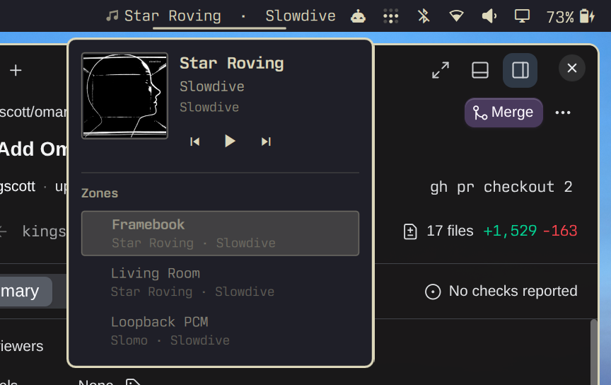
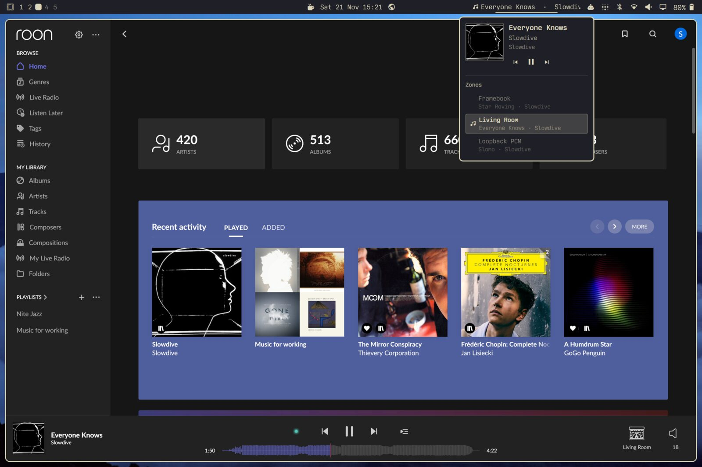

# omarchy-roon

This repository contains two things for running Roon on Arch Linux and Omarchy:

- **`roon-proton`**: an Arch package that runs the Windows Roon desktop app
  through Proton and UMU. The app works as a **Roon Control** and as a local
  audio **Output**. The recommended output uses native Roon Bridge and PipeWire,
  so playback follows the desktop's selected speakers, headphones, USB DAC, or
  Bluetooth sink.
- **Omarchy bar plugin** (in [`plugin/`](plugin/)): a bar widget that shows what
  is playing on Roon and moves playback between zones.

The package and primary command are named `roon-proton`. The legacy `roon-wine`
command remains as an alias and uses the same configuration and prefix data.

This project does not redistribute Roon. The installer is downloaded directly
from Roon Labs when you run `roon-proton install`.

## Contents

- [Install](#install)
  - [From the AUR](#from-the-aur)
  - [From GitHub or with makepkg](#from-github-or-with-makepkg)
  - [Upgrading from 0.2.0-9 or earlier](#upgrading-from-020-9-or-earlier)
- [Usage](#usage)
  - [Commands](#commands)
  - [Display](#display)
  - [Audio output modes](#audio-output-modes)
  - [Tiling window managers](#tiling-window-managers)
  - [Updating or removing](#updating-or-removing)
- [Omarchy bar plugin](#omarchy-bar-plugin)
- [Troubleshooting](#troubleshooting)
- [Reference](#reference)
  - [Security model](#security-model)
  - [Runtime policy](#runtime-policy)
  - [Compatibility status](#compatibility-status)
- [Development](#development)

## Install

### From the AUR

Package page: [AUR: roon-proton](https://aur.archlinux.org/packages/roon-proton)

`umu-launcher` is in Arch's `multilib` repository. CachyOS normally enables it,
but a fresh plain-Arch installation may not. If `yay` reports that
`umu-launcher` cannot be found, uncomment these two lines in `/etc/pacman.conf`
and run `sudo pacman -Syu` before continuing:

```ini
[multilib]
Include = /etc/pacman.d/mirrorlist
```

On a minimal Arch installation, pacman may also ask which Vulkan providers to
install for UMU. Select the entries matching the actual GPU: typically
`vulkan-radeon`/`lib32-vulkan-radeon` for AMD,
`vulkan-intel`/`lib32-vulkan-intel` for Intel, or the matching NVIDIA packages.
Do not blindly accept the first provider, which may target different hardware.

On a PipeWire desktop, install the package and run the automated setup:

```sh
yay -S roon-proton
sudo modprobe snd-aloop pcm_substreams=1
roon-proton setup
```

The package makes `snd-aloop` load automatically on future boots; the `modprobe`
command only makes it available immediately after the first installation. After
a reboot, only `roon-proton setup` is needed. That command installs Roon in the
user account, configures the recommended endpoint, and launches the controller.

When Roon opens, go to **Settings > Audio**, enable the first **Loopback PCM**,
and name it **System Output (PipeWire)**. Leave the second Loopback PCM disabled.
That is the only manual audio step.

For a controller-only installation, a PulseAudio desktop, or a system without
systemd user services, use `roon-proton setup desktop`. This package does not
silently replace PulseAudio with PipeWire. The default System Output mode
requires the optional `pipewire-audio` and `wireplumber` packages;
`pipewire-pulse` is only needed for the Wine compatibility output.

Pacman cannot safely perform the per-user setup itself: package install hooks run
as root, while the proprietary Roon download, prefix, services, and GUI belong to
the logged-in desktop user. Keeping that boundary also prevents the AUR package
from redistributing Roon.

### From GitHub or with makepkg

If the new package has not reached your AUR helper's search index yet, build the
same package directly from its GitHub checkout:

```sh
sudo pacman -S --needed git base-devel
git clone --depth=1 https://github.com/massiveadam/roon-wine.git
cd roon-wine
yay -Bi --needed .
```

Then continue with `modprobe` and `roon-proton setup` from the AUR steps above.

To install with makepkg and set up Roon by hand:

```sh
makepkg -si
roon-proton install
roon-proton run
```

The prefix is stored in `${XDG_DATA_HOME:-~/.local/share}/roon-wine/prefix`.
Configuration is stored in `${XDG_CONFIG_HOME:-~/.config}/roon-wine/config`.

### Upgrading from 0.2.0-9 or earlier

Update the AUR package and launch Roon normally:

```sh
yay -S roon-proton
```

The first launch detects the old enabled System Output relay, changes that
zone to shared PipeWire output, and removes the obsolete relay service. The
migration runs once. Controller-only and direct-mode installations are left
unchanged.

## Usage

### Commands

```text
roon-proton setup [system|desktop|direct] install, configure, and launch Roon
roon-proton install              create or repair the prefix and install Roon
roon-proton update               install the pinned Roon build and keep user data
roon-proton run                  launch Roon
roon-proton doctor               report display, audio, Wine, and prefix state
roon-proton configure            apply the configured display/audio backends
roon-proton winecfg              open Wine configuration for the managed prefix
roon-proton set display auto     auto, wayland, x11, or xwayland
roon-proton set audio pipewire   pipewire, pulse, or alsa
roon-proton set scale 1.5        positive decimal scale factor
roon-proton set runner proton    proton (default) or wine fallback
roon-proton runtime              download and verify the pinned Proton runtime
roon-proton endpoint install     install the optional native Linux endpoint
roon-proton endpoint start|stop  control the native audio endpoint
roon-proton endpoint status      show endpoint service status
roon-proton endpoint release     stop playback and release the ALSA device
roon-proton endpoint mode desktop use Wine System Output through PipeWire
roon-proton endpoint mode system  use System Output (PipeWire) (recommended)
roon-proton endpoint mode direct  enable native Bridge for direct ALSA devices
roon-proton kill                 stop processes in the managed prefix
```

With the fallback Wine runner selected, use `roon-proton winecfg` after
installation when manual Wine device, graphics, desktop-integration, or library
settings are needed. It always opens the prefix managed by this package rather
than your default Wine prefix.

### Display

The default `display=auto` uses XWayland with the pinned Proton runtime. Testing
found that Proton 10 avoids Wine 11's Roon crash, while XWayland avoids Proton
10's second-OpenGL-context failure on native Wayland. In a traditional X11
session, `auto` uses X11 directly. Forced Wayland and X11/XWayland modes fail
with a clear diagnostic when their required display socket is unavailable.

### Audio output modes

Roon offers three ways to play on this computer. They are mutually exclusive in
one user session.

| Mode | Command | Route |
| --- | --- | --- |
| System (recommended) | `roon-proton endpoint mode system` | Native Bridge to PipeWire, following the desktop output |
| Desktop | `roon-proton endpoint mode desktop` | Wine System Output through PipeWire |
| Direct | `roon-proton endpoint mode direct` | Native Bridge to a hardware ALSA device |

#### System mode

For normal laptop use, install the native endpoint and activate system mode:

```sh
roon-proton endpoint install
roon-proton endpoint mode system
```

Then enable the first **Loopback PCM** device in Roon Settings > Audio, name it
**System Output (PipeWire)**, and use it as the laptop zone. The route is:

```text
Roon Core -> native Roon Bridge -> ALSA plug:pipewire
          -> PipeWire -> MassiveEQ/desktop default output
```

It follows the currently selected laptop speakers, wired headphones, USB audio,
or Bluetooth device and appears in normal PipeWire media and volume controls.
Native Roon Bridge only lists kernel ALSA `hw:` devices in Settings, so system
mode keeps the first Loopback PCM as the visible zone identity and rewrites that
zone's saved RAAT output to `plug:pipewire`. PipeWire handles source-rate
conversion, mixing, output switching, and filters without locking Roon to one
sample rate.

For a clean zone picker, leave only **System Output (PipeWire)** enabled for this
computer. Disable the second Loopback PCM, Wine **System Output**, direct laptop
audio, and unused HDMI devices in Roon Settings > Audio. Roon still lists those
ALSA devices on the Settings page because it discovers host hardware itself;
disabled devices do not appear as playback zones. The second Loopback PCM is not
used by the PipeWire route.

#### Desktop mode

`endpoint mode desktop` retains the Wine `System Output` path as a compatibility
option. Some Wine/Proton combinations reject ordinary PCM formats on that path.

#### Direct mode

Roon talks to the native RAAT endpoint, which opens the hardware ALSA device
without a desktop mixer or Wine audio layer. It is independent of the controller
window and does not appear as a PipeWire media session.

```sh
roon-proton endpoint install
roon-proton endpoint mode direct
```

Direct mode is meant for experimentation with dedicated devices. It may conflict
with PipeWire device ownership and is not assumed to provide exclusive or
bit-perfect playback. Verify those properties in Roon's signal path and against
the selected Linux device. Use `roon-proton endpoint release` if the controller
has closed while the core is still playing or another app needs the device.

#### Switching modes

Both endpoints use the same RAATServer rendezvous. Switching to system or direct
mode stops the managed Roon session and its Proton launcher, starts native Bridge
first, and requires a Roon relaunch. This ordering prevents the Windows
local-output server from owning the rendezvous while native Bridge appears
healthy but has no RAATServer child. Switch back with
`roon-proton endpoint mode desktop`, then relaunch Roon.

### Tiling window managers

Roon's main window has the class `steam_app_0` and the title `Roon`. Niri and
Hyprland rules that tile it are packaged under `/usr/share/roon-proton/wm`. See
[docs/window-managers.md](docs/window-managers.md) for the include lines.

### Updating or removing

An AUR installation updates normally through `yay`:

```sh
yay -Syu
```

Pacman updates the system package but cannot modify a user's Wine/Proton prefix.
When Roon Labs publishes a controller build, update the AUR package first and
then install its pinned, verified payload into the existing prefix:

```sh
roon-proton update
```

This preserves the Roon database and settings. Roon's Windows updater may
download an update successfully and then crash while running its installer
under Proton; `roon-proton update` avoids that installer path.

If you used the GitHub checkout, update it with:

```sh
cd roon-wine
git pull --ff-only
yay -Bi --needed .
```

Remove the packaged launcher with `yay -Rns roon-proton`. User data is left in
`${XDG_DATA_HOME:-~/.local/share}/roon-wine`; remove that directory only when you
intentionally want to discard the Roon prefix and its settings.

## Omarchy bar plugin

The [`plugin/`](plugin/) folder holds an Omarchy bar widget that shows what is
playing on Roon, opens Roon when the album art is clicked, and moves playback
between zones. See [plugin/README.md](plugin/README.md) for setup.





## Troubleshooting

Start with the diagnostics report:

```sh
roon-proton doctor
```

**Install fails with "checksum verification failed".** Roon's installer and
Roon Bridge download URLs always serve the latest build. When Roon publishes a
new one, the hashes pinned in the launcher stop matching and installation stops
safely until the package maintainer reviews the new artifact and publishes
updated hashes.

**Roon cannot find the endpoint or the Core.** If UFW blocks discovery, allow
only your trusted LAN (adjust the subnet):

```sh
sudo ufw allow from 192.168.12.0/24
```

If neither the native Bridge nor the Windows endpoint appears in Roon while
existing network zones still work, restart Roon Server on the Core. In one
recorded case, stale Core-side RAAT discovery state caused this; see
[docs/testing.md](docs/testing.md).

**Another app needs the audio device, or playback continues after Roon closed.**
Run `roon-proton endpoint release`.

**The bar plugin does not update after an edit.** Run `omarchy restart shell`.
More plugin notes are in [plugin/README.md](plugin/README.md).

## Reference

### Security model

The launcher and its user services never request root privileges. Pacman only
installs the package-owned launcher, display rules, and the `snd-aloop`
module-load setting. Configuration files are parsed as data and are never
sourced or evaluated as shell code.

The Proton runtime, Roon installer, and Roon Bridge archive are restricted to
HTTPS and verified against package-pinned SHA-512 hashes before execution or
extraction. The pinned Windows installer was also checked for its Harman
International Authenticode signature when the package hash was updated.

Roon and Roon Bridge remain proprietary network applications running with the
desktop user's permissions; Wine/Proton is a compatibility layer, not a security
sandbox. Roon Labs controls update availability, while this package pins and
verifies each controller installer before `roon-proton update` extracts it into
the managed prefix. Users requiring isolation should run Roon under a separately
tested sandbox or dedicated user account.

### Runtime policy

The launcher pins and verifies GE-Proton 10 instead of following an untested
`latest` release. The roughly 500 MiB runtime archive is cached under
`${XDG_CACHE_HOME:-~/.cache}/roon-wine`; the extracted runtime and prefix live
under `${XDG_DATA_HOME:-~/.local/share}/roon-wine`. `roon-proton set runner wine`
is available for diagnosis. The launcher disables Wine's incomplete
`wminet_utils` helper, but the pinned Proton path remains the tested default.

Arch currently ships UMU 1.4.0, whose command-launcher service can end the Roon
process as soon as the launcher returns. The package includes a narrow 1.4.0
compatibility runner that disables that service, matching upstream UMU 1.4.1's
default behavior. The current Roon NSIS bootstrapper also crashes under Proton;
the package therefore extracts its bundled 64-bit controller directly after
verifying the complete upstream installer against the pinned SHA-512 hash.

### Compatibility status

- **CachyOS, Niri, Wayland + XWayland:** live-tested controller, tiling, and
  PipeWire System Output on the Framework laptop.
- **Plain Arch x86_64:** the complete dependency transaction, clean package
  build, package install, UMU 1.4.0 compatibility path, and CLI diagnostics are
  tested in a current Arch container with `multilib` enabled. A container cannot
  validate a real GPU, compositor, Bluetooth device, or sound card.
- **Traditional X11:** selected automatically when `XDG_SESSION_TYPE=x11`; the
  environment and failure paths are tested, but the Roon UI has not been
  live-tested in a real X11 login.
- **GNOME, KDE Plasma, Sway, and Hyprland:** expected to use the same XWayland
  controller path. Niri and Hyprland rules are included; only Niri has been
  live-tested. Other compositors use their normal window behavior.
- **EndeavourOS and Garuda:** expected to follow the plain-Arch requirements,
  including `multilib`, but are not live-tested.
- **Manjaro:** best-effort only. Its repositories can lag Arch; the package
  requires UMU 1.4.0 or newer rather than accepting an untested older launcher.
- **Artix/non-systemd:** controller-only mode is the supported path. The native
  endpoint automation uses systemd user services and exits with a clear
  explanation instead of failing midway.
- **PulseAudio-only systems:** controller-only mode is supported without forcing
  an audio-stack replacement. PipeWire System Output is unavailable until you
  migrate to PipeWire.
- **Forced native Wayland:** experimental. The tested Proton build fails Roon's
  second OpenGL context there, so `auto` chooses XWayland.

Roon Server is out of scope because Roon provides a native Linux build. This
package manages the desktop controller and can install the official native Roon
Bridge as the recommended local audio endpoint.

## Development

Run the static checks:

```sh
make check
```

On macOS or Linux with Docker, build and inspect the x86_64 Arch package in a
disposable container:

```sh
make check-arch
```

The container enables Arch `multilib`, resolves every hard dependency, builds
and installs the package, and runs its CLI smoke test without installing system
Wine. A full Roon test requires an x86_64 Linux VM with a graphical desktop and
audio devices; containers cannot faithfully exercise that path.

On the development Mac, the dedicated Colima runtime is stored under
`/Volumes/NVMe/Roon Arch Linux Test`. The test uses that runtime automatically
when its Docker socket is available. Set `ROON_ARCH_DOCKER_SOCKET` to override
the socket path; on other systems the active Docker context is used.

Further reading:

- [docs/architecture.md](docs/architecture.md): design boundaries and the
  planned test matrix.
- [docs/testing.md](docs/testing.md): recorded results and the
  physical-hardware release smoke test.
- [docs/window-managers.md](docs/window-managers.md): tested Niri and Hyprland
  tiling rules.
- [docs/aur-publishing.md](docs/aur-publishing.md): publishing the package to
  the AUR.
- [plugin/README.md](plugin/README.md): the Omarchy bar plugin.

Agent skills for debugging live in [`.claude/skills/`](.claude/skills/); see
[AGENTS.md](AGENTS.md).
