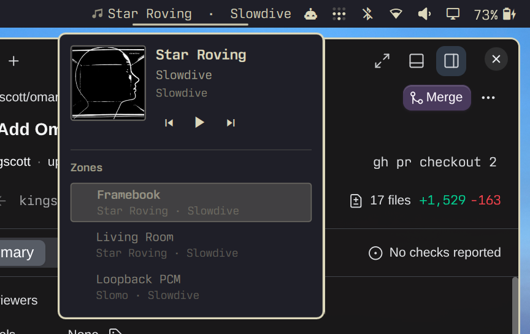

# Roon for the Omarchy bar

Shows what is playing on Roon in the Omarchy bar.



- The bar shows the current track and artist.
- Click the widget to open a card with album art, play controls, and your zones.
- Click the album art to open Roon (or focus it if it is already open).
- Click a zone to show it. If the clicked zone is not playing, the music moves
  to it from the shown zone, or from the only other zone that is playing.
- Middle-click the widget to play or pause. Scroll on it to skip tracks.
- Open or close the card from a hotkey with `omarchy-shell shell toggle kingscott.roon '{}'`.

## Setup

1. From the repo root, link the plugin folder into Omarchy's plugin directory and enable it:

   ```bash
   ln -s "$PWD/plugin" ~/.config/omarchy/plugins/kingscott.roon
   omarchy plugin enable kingscott.roon
   ```

2. Set your Roon Core's address on the widget's entry in `~/.config/omarchy/shell.json`:

   ```json
   { "id": "kingscott.roon", "coreHost": "192.168.1.20" }
   ```

   `corePort` defaults to `9330`.

3. In Roon, open **Settings > Extensions** and enable **Omarchy Roon**. This is needed once per Roon Core.

## How it works

`roon-helper.py` connects to the Roon Core as a Roon extension and talks to the
widget over JSON lines on stdin and stdout. It uses only the Python standard
library. It runs while the widget is on the bar, and only one copy runs, even with several monitors.

- The pairing token is saved in `~/.config/omarchy-roon/state.json`.
- Album art is downloaded as JPEG into `$XDG_RUNTIME_DIR/omarchy-roon/art/`, and
  the widget only loads those local files.
- The helper connects only to the Core address you set.

Run `omarchy restart shell` after editing any plugin file. The shell does not
watch files behind the symlink, and it keeps `RoonService.qml` loaded across
plugin reloads.
